# Sweep

A Windows cleanup console that finds the space Windows quietly gives away, stops
the apps you are not using, and removes a program completely — without ever
letting a bad guess become a one-way door.

One engine, two front ends: a keyboard-driven **terminal console** and a
**local web interface** that runs at `http://127.0.0.1:8765`. Your files,
quarantine and settings stay on your PC. The only optional outbound request is
the update check, and you can turn it off.

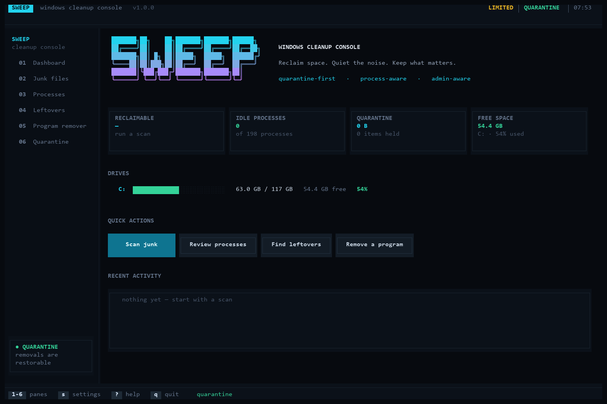

## What it does

| Feature | Job |
| --- | --- |
| **Junk files** | 18 categories: user and Windows temp, Prefetch, Windows Update cache, Delivery Optimization, `Windows.old`, crash dumps, WER, thumbnails, WinINet, browser and GPU shader caches, Windows logs, developer/build caches, installer patches, `ProgramData` package cache and the Recycle Bin. |
| **Processes** | Classifies every process as active, tray, service, Windows or idle, and stops the idle ones on request. |
| **Leftovers** | Finds folders in AppData, ProgramData and Program Files that no installed program claims and nothing has touched for three weeks. |
| **Program remover** | Takes a program name, searches every fixed drive (hidden and system paths included), and removes the folders, files, registry keys and services that match. |
| **Quarantine** | Everything removed lands here first, on the same drive it came from, and can be restored or purged later. |
| **Updates** | Optional check for a newer release, with a verified HTTPS download, SHA-256 check, backup and automatic rollback. |

### Junk files

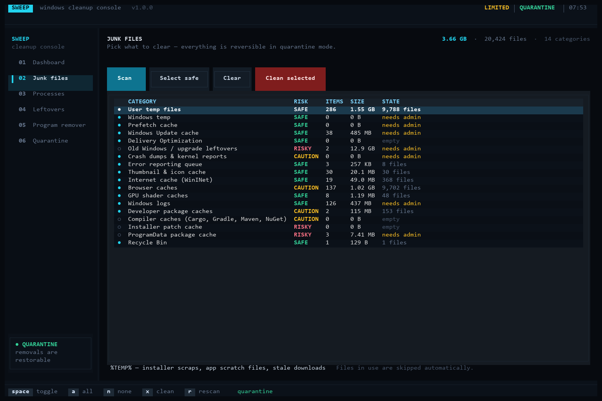

Every category is measured before anything is touched, and risky categories are
never pre-selected. Categories that need Administrator are labelled `needs
admin` instead of silently doing nothing.

### Processes

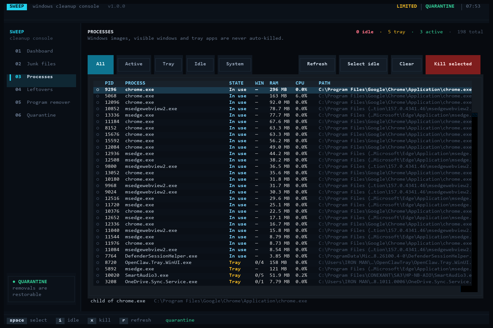

Sweep will not kill a process that is a Windows image, a service, has a visible
window, lives in the tray, or is a child of something it is keeping. What is
left — a third-party app with no window and no tray presence — is what it calls
*idle*.

### Leftovers

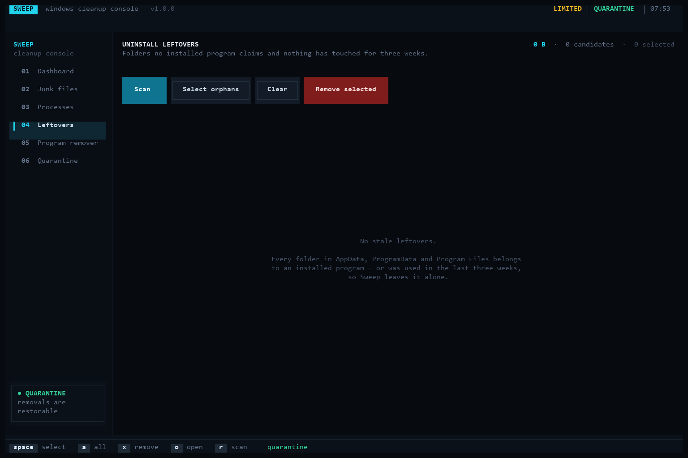

A folder only qualifies when the registry, Program Files, Start Menu shortcuts
and publisher metadata all fail to explain it, **and** its last write is older
than three weeks. Recently touched folders are always left alone.

### Program remover

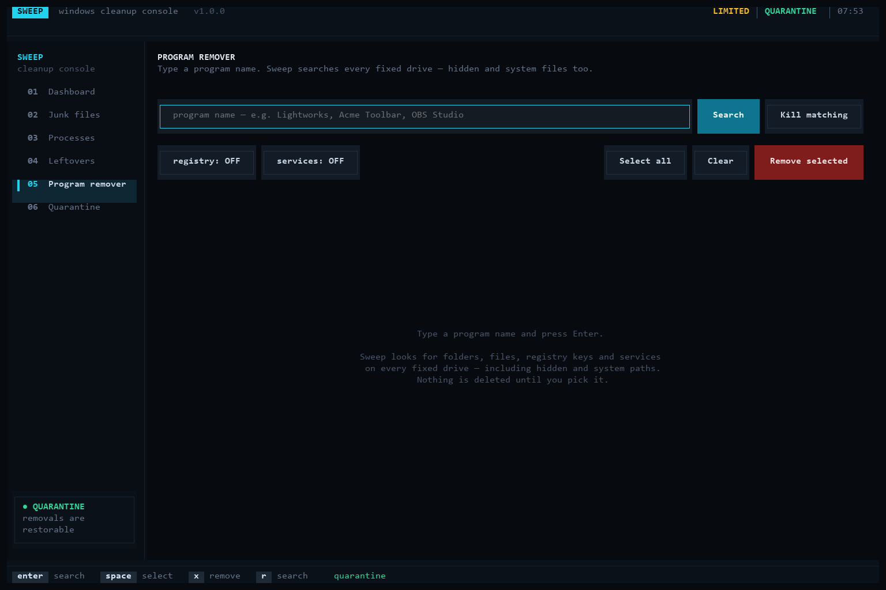

Search first, then choose exactly what goes. Registry keys and services are
opt-in and backed up before they are touched.

### Quarantine

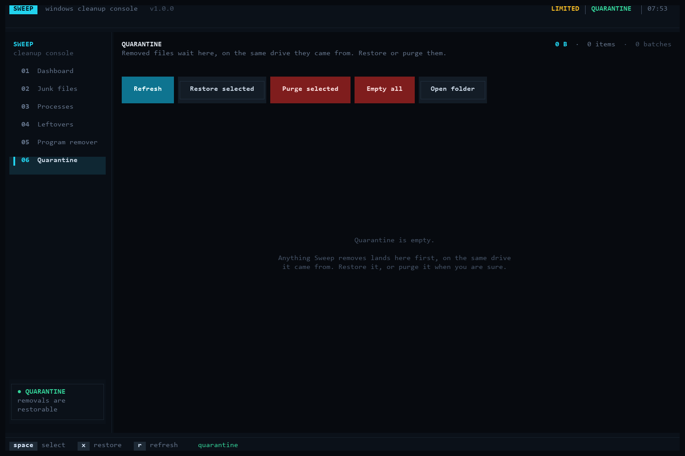

Removals are moves, not deletes. A batch keeps its manifest, so restoring puts
every file back at its original path. Purging is the only irreversible action,
and it asks you to type a word to confirm.

## Safety model

- **Quarantine by default.** Files are moved to a per-volume holding area
  (`%LOCALAPPDATA%\Sweep\quarantine\<batch>` on `C:`, `D:\$SweepQuarantine`
  elsewhere) with a JSON manifest.
- **Hard refusals.** Drive roots, `$Recycle.Bin`, `System Volume Information`,
  `pagefile.sys`, `hiberfil.sys`, `swapfile.sys`, `NTUSER.DAT`, `System32`,
  `WinSxS`, `Fonts`, `Installer`, `WindowsApps`, your Desktop / Documents /
  Downloads / Pictures / Music / Videos / OneDrive, `.ssh`, `.gnupg`, `.aws` and
  the DPAPI credential stores are rejected even if a scanner suggests them.
- **Category-scoped.** A delete is only allowed inside the roots that belong to
  the category it came from — a junk scan cannot reach into Program Files.
- **Typed confirmation** for permanent deletes, large removals, big process
  kills and emptying quarantine.
- **Everything is logged** to `%LOCALAPPDATA%\Sweep\logs\`, and every batch is
  restorable.

## Install

Sweep is portable: there is no installer, no service, and nothing is written to
`Program Files`. No Administrator rights are required. The portable zip is the
build that can update itself. Official releases bundle a private Python runtime
in a `runtime\` folder next to `main.py`, so they need nothing installed — on any
Windows 10/11 PC or laptop, extract and double-click. A source-style zip without
that folder needs Python 3.10+ once; a standalone `Sweep.exe` build needs no
Python but has to be replaced by hand. See
[Run from source](#run-from-source) for the checkout route.

1. Download `Sweep-<version>.zip` from the Releases page.
2. Right-click the zip → **Extract All…** and pick a folder you can write to.
   `Documents\Sweep`, `D:\Tools\Sweep`, a USB drive or a OneDrive folder all
   work. Don't run it from inside the zip — Windows mounts that read-only.
3. Double-click **`Sweep Web.bat`** for the web interface, or **`run.bat`** for
   the terminal console.
4. Keep the folder. Make a shortcut to `Sweep Web.bat` if you like; the app *is*
   the folder, not an installed program.

Windows 10 or 11, 64-bit. It fits a 1366×768 laptop and smaller screens: the web
interface collapses to one column, and the terminal console is happy in a normal
terminal window.

Administrator is optional. It unlocks the categories that touch `C:\Windows`
(Windows temp, Prefetch, Windows Update cache, `Windows.old`, Windows logs,
`ProgramData` cache); everything else works as a standard user. Right-click the
launcher → **Run as administrator** for those.

Full details — USB drives, OneDrive, SmartScreen and uninstalling — are in
[docs/INSTALL.md](docs/INSTALL.md).

### Run from source

A checkout needs Python 3.10 or newer; the dependencies are vendored, so there
is nothing to `pip install`.

```bat
py -3 main.py
```

`run.bat` finds `py -3`, `python` or `python3`, then a runtime bundled next to
the app, and prints a clear message if none is usable. Use **Windows Terminal**
for the intended look:
true colour and a font with box drawing and block glyphs (Cascadia Mono,
Consolas, JetBrains Mono). Sweep respects `NO_COLOR`.

### Keys

| Key | Action |
| --- | --- |
| `1` – `6` | switch panes |
| `r` | rescan / refresh the current pane |
| `space` | toggle the highlighted row |
| `a` / `n` | select all / none |
| `x` | run the pane's main action (clean, kill, remove, restore) |
| `i` | processes: select every idle process |
| `o` | leftovers: open the highlighted folder |
| `u` | check for updates |
| `s` | settings (including Updates) |
| `?` | help |
| `q` | quit |

## Web interface

Double-click **`Sweep Web.bat`** — it starts a local server, prints the address
and opens your browser. Nothing is installed, nothing is uploaded, and the
server binds `127.0.0.1` only.

```bat
py -3 main.py web                 :: http://127.0.0.1:8765
py -3 main.py web --port 9000 --no-browser
```

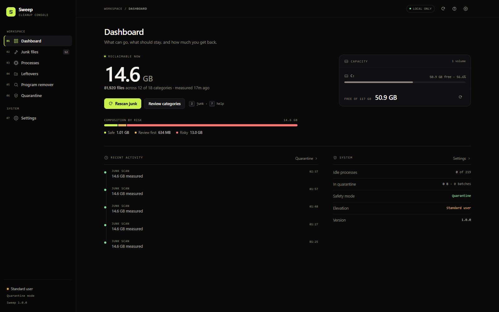

The same engine, with the same safety model, in a layout built for a mouse and a
phone — one column on small screens, cards instead of tables, and bottom-sheet
dialogs:

| Page | What it adds |
| --- | --- |
| **Dashboard** | Reclaimable space, drive usage, idle processes, quarantine size, recent activity, quick actions. |
| **Junk files** | 18 categories with size, file count, risk and status; multi-select, “select safe”, typed confirmation. |
| **Processes** | Live classification with filters for in use / idle / tray / locked / service / Windows apps, search by name or PID, and a kill list. |
| **Leftovers** | Orphan folders with confidence, age and the reason they were flagged. |
| **Program remover** | Search every drive by name, opt into registry keys and services, then remove only what you ticked. |
| **Quarantine** | Restore, purge, empty — with the batch, item count and size in front of you. |

| | |
|---|---|
| 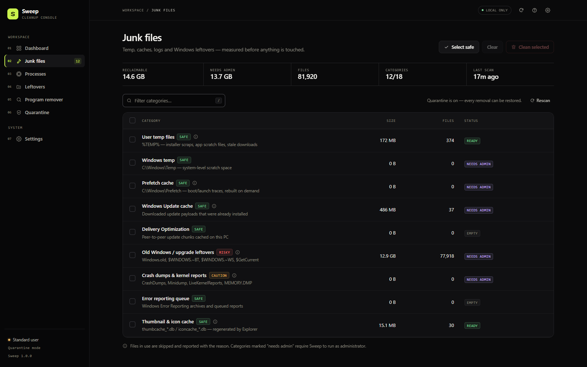 | 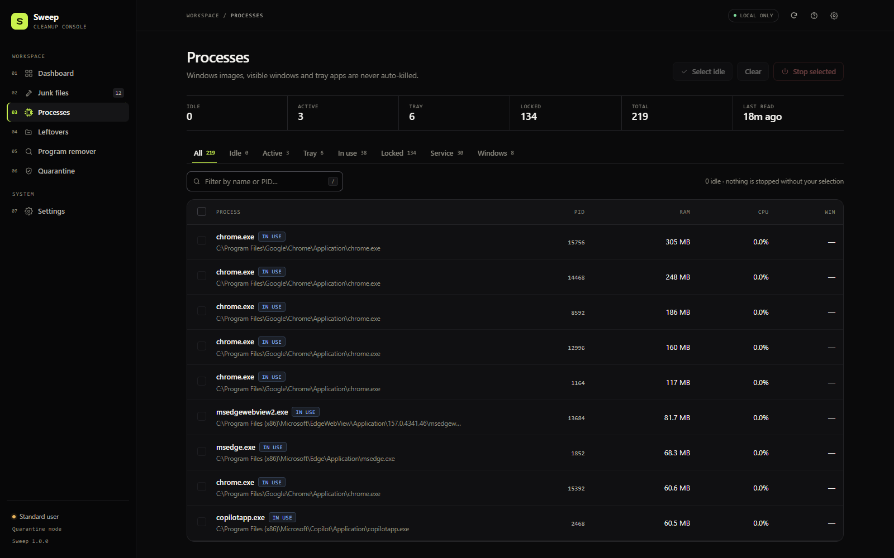 |
| 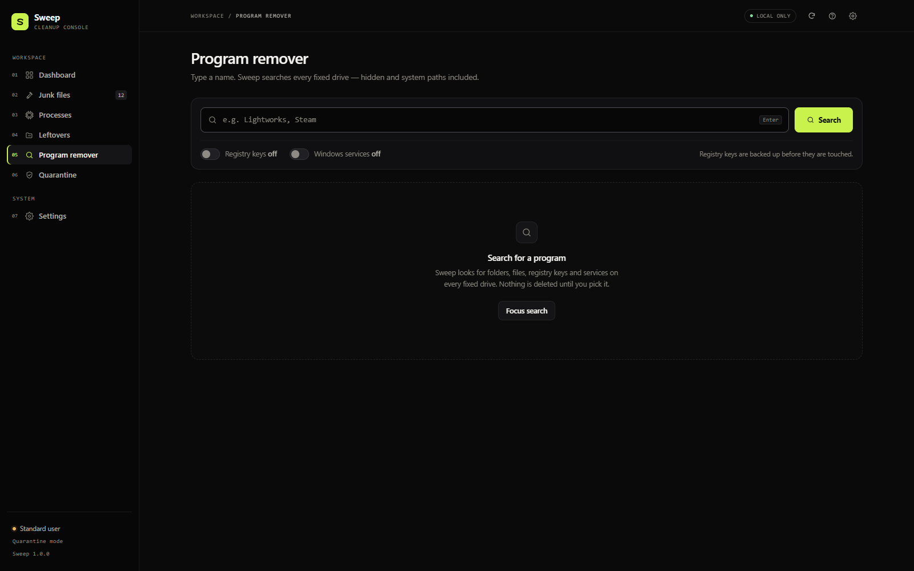 | 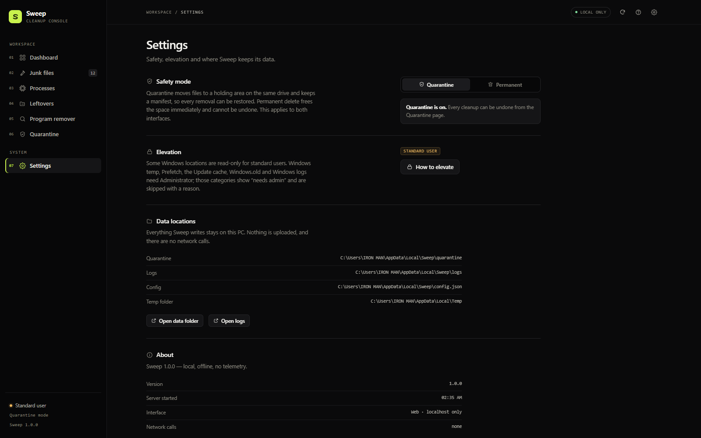 |

Keyboard: `/` jumps to the page's filter or search field, `1`–`7` switch pages,
`?` opens the help sheet, and `Esc` closes dialogs and sheets. Every control is
reachable by Tab, the current page is announced on change, and the layout honours
`prefers-reduced-motion`.

### Errors that explain themselves

Every failure in the API — and every failure in the interface — carries three
things: **what failed**, **the concrete reason**, and **what to do next**.
Windows error codes are translated instead of forwarded:

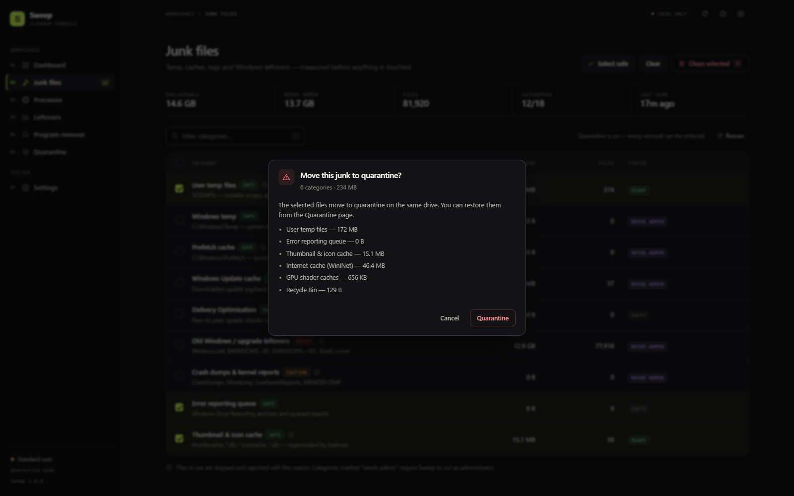

```json
{
  "ok": false,
  "error": {
    "code": "access_denied",
    "message": "Windows would not let Sweep remove this file",
    "reason": "C:\\Windows\\Temp\\setuperr.log is owned by TrustedInstaller; a standard user token cannot write to it (Windows error 5: access is denied).",
    "hint": "Run Sweep Web.bat as administrator, or skip this category.",
    "details": { "path": "C:\\Windows\\Temp\\setuperr.log" }
  }
}
```

When a cleanup hits files that are open elsewhere, the result names **every**
file that could not be moved, with its own reason — not one opaque message. The
junk and leftovers pages keep a report panel until it is dismissed:

```json
{
  "failed": 1,
  "failures": [
    { "path": "C:\\WINDOWS\\...\\State\\dosvcState.dat", "reason": "[WinError 32] ..." },
    { "path": "C:\\WINDOWS\\...\\State\\dosvcState.dat.LOG1", "reason": "[WinError 32] ..." }
  ],
  "errors": [{
    "code": "delete_failed",
    "reason": "dosvcState.dat — in use by another process (and 1 more file)",
    "short": "in use by another process",
    "hint": "Windows Delivery Optimization (the DoSvc service) keeps these files open. Stop that service, or skip this category.",
    "details": [
      { "path": "C:\\WINDOWS\\...\\dosvcState.dat", "short": "in use by another process" },
      { "path": "C:\\WINDOWS\\...\\dosvcState.dat.LOG1", "short": "in use by another process" }
    ]
  }]
}
```

Files that did move before the locked one are still recorded in the quarantine
manifest, so they can be restored even when the folder as a whole failed. Moves
are rename-only: a locked file never leaves a half-copied duplicate behind.

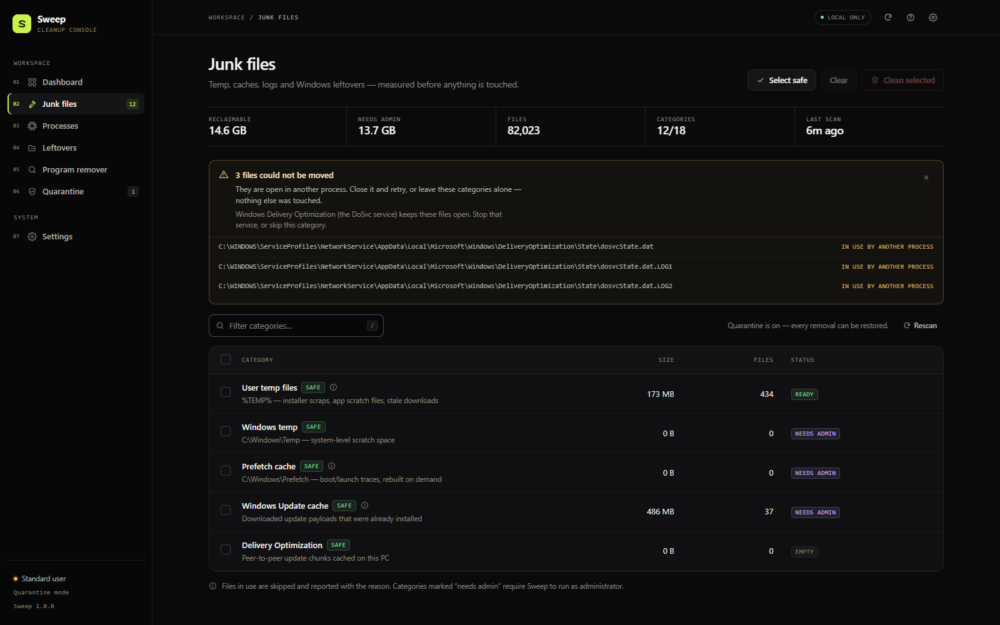

Long-running work (scans, cleanups, searches, removals) is a background job with
a progress bar, a message per phase and a Cancel button. Jobs survive page
reloads; the interface reattaches to the active one. Only one destructive job can
run at a time, and the second one is refused with `operation_in_progress` rather
than interleaved.

### Local-only by construction

- Binds `127.0.0.1`; the API refuses requests whose `Origin` or `Host` is not
  this server, which blocks CSRF and DNS-rebinding attempts from other sites.
- The server mints a random token at startup and embeds it in the page; the API
  requires it in `X-Sweep-Token`, so another local process cannot drive the API
  blind.
- A strict `Content-Security-Policy` and no external assets — the whole UI is
  three files served by the same process, and it works offline.
- No telemetry, no fonts, no CDN, no analytics. The only optional outbound
  request is the update manifest, and it can be turned off.

## Keeping Sweep up to date

Sweep can update itself without an installer, a package manager or
Administrator rights. A release is a zip of files; an update verifies the zip,
backs up what it replaces, swaps the files after Sweep exits, and restarts
Sweep.

- **Automatic check.** On launch, Sweep asks one small JSON manifest whether a
  newer release exists — at most once every 6 hours by default. The answer is
  remembered, so launches inside that window make no request. Turn the check off
  in **Settings → Updates** and Sweep makes no outbound request at all.
- **Manual check.** **Settings → Updates → Check now**, or `sweep update
  --check` from a Command Prompt in the Sweep folder (`py -3 main.py update
  --check` from a checkout). The manual check ignores the 6-hour interval, but
  not the on/off switch.
- **Channels.** `stable` (the default) ignores releases marked beta; `beta` is
  offered prereleases too. Change it in Settings → Updates.
- **Verified download.** The manifest carries the SHA-256 of the release zip.
  Sweep refuses a release with no checksum, verifies the bytes it received, and
  refuses an archive whose own version stamp disagrees with the manifest.
- **Backup and rollback.** Every file about to be replaced is copied to
  `%LOCALAPPDATA%\Sweep\updates\backup-<old-version>-<timestamp>` first. If any step
  fails, the helper restores the backup and starts the old version again. A
  manual rollback is `sweep update --rollback`, or
  `py -3 sweep_app\updater.py --restore <folder> --relaunch` for a specific
  older backup (that form needs Python).
- **Where it lives.** Downloads, staging, apply plans and backups are under
  `%LOCALAPPDATA%\Sweep\updates`; the helper writes
  `%LOCALAPPDATA%\Sweep\logs\update-<timestamp>.log` and
  `updates\update-status.json`. Your quarantine, logs and settings are outside
  the install folder and are never touched.

### What goes over the network

Exactly one request, and only if the check is enabled:

```http
GET https://github.com/OWNER/REPO/releases/latest/download/latest.json
User-Agent: Sweep/1.1.0 (+local update check)
Accept: application/json
```

There is no query string, no cookie and no identifier: nothing about you, your
PC, your Windows version, your files or how you use Sweep. If you choose to
install, a second `GET` fetches the release zip named in that manifest, with the
same User-Agent. That is the only other request the app can make.

There is no telemetry, no analytics, no CDN, no font download and no background
service. With the check turned off, Sweep is completely offline — and it stays
fully usable offline either way.

The full user guide is [docs/UPDATES.md](docs/UPDATES.md); the maintainer
runbook is [docs/RELEASING.md](docs/RELEASING.md).

## Command line

The interface is a front end; every action is also a command, which makes it
easy to script or inspect.

```bat
py -3 main.py scan                      :: measure reclaimable space
py -3 main.py clean --yes               :: quarantine the default categories
py -3 main.py clean --categories user_temp,browser_cache --yes
py -3 main.py procs                     :: list processes and verdicts
py -3 main.py procs --kill-idle --yes
py -3 main.py leftovers
py -3 main.py search "obs studio" --registry --services
py -3 main.py quarantine                :: list batches
py -3 main.py quarantine --restore 20261112-070646
py -3 main.py quarantine --purge-all
py -3 main.py update                    :: report the update status (cached ok)
py -3 main.py update --check            :: ask the release manifest now
py -3 main.py update --install --yes    :: download, verify and install
py -3 main.py update --rollback         :: restore the most recent backup
py -3 main.py web                       :: local web interface
```

`clean` without `--yes` only reports what it would do. `update` never replaces
files without `--install --yes`; add `--dry-run` to download and stage without
applying, and `--json` for machine-readable output.

## How classification works

**Processes** — a process is kept when it is a Windows image (under `%WINDIR%`
or WindowsApps), a session-0 service, a process with a visible window, a process
with a hidden titled window or a known tray hint, or a descendant of one of
those (walking up to `explorer.exe`). Idle processes are the remainder.

**Leftovers** — an index is built from the three Uninstall registry hives,
Program Files folder names, Start Menu shortcuts and executable version
metadata (company/product). A candidate folder is skipped when its name,
publisher or product string matches anything in that index, when it is a known
system or tooling folder, or when it was written to in the last 21 days.

## Requirements and limits

- Windows 10 or 11, 64-bit. A release that bundles its runtime (or ships a
  standalone `Sweep.exe` build) needs no Python; the source-style zip and a
  source checkout need Python 3.10+.
- Any screen size: the web interface reflows to one column, and the terminal
  console works in a normal terminal window. 1366×768 laptops are a first-class
  target.
- No Administrator rights needed, but some categories (Windows temp, Prefetch,
  Windows Update cache, `Windows.old`, Windows logs, `ProgramData` cache) are
  read-only or blocked without elevation. Sweep says so instead of pretending.
- Files held open by another process are skipped and reported; close the app and
  rescan.
- `Windows.old` removal is best done through Disk Cleanup or Storage Sense;
  Sweep will quarantine it only when it has the rights to do so.
- Restoring a quarantined file fails if something has since taken its original
  path; the batch stays in quarantine so you can move it by hand.

## Files

| Path | Contents |
| --- | --- |
| `%LOCALAPPDATA%\Sweep\quarantine\` | restorable batches and manifests |
| `%LOCALAPPDATA%\Sweep\logs\` | `sweep-<date>.log` activity log and `update-<stamp>.log` helper logs |
| `%LOCALAPPDATA%\Sweep\config.json` | settings: delete mode, update channel, interval and on/off switch, last check result |
| `%LOCALAPPDATA%\Sweep\updates\` | downloaded zips, staging, apply plans, `backup-*` folders and `update-status.json` |

Delete that folder to forget everything Sweep knows. Deleting it also destroys
anything still in quarantine, so restore or purge first if you care about those
files.

## Project layout

```
main.py                 entry point (adds vendor/ to sys.path)
run.bat                 terminal launcher
Sweep Web.bat           web launcher
sweep.cmd               "sweep" command shim for a checkout or portable folder
Sweep.spec              PyInstaller recipe for the standalone exe build
pyproject.toml          metadata, dependencies and the `sweep` console script
CHANGELOG.md            release notes, one section per version
sweep_app/
  cli.py                argument parsing, text output
  cli_update.py         the `sweep update` command and its exit codes
  config.py             one atomic settings store (delete mode + update prefs)
  updates.py            manifest check, verified download, staging, apply
  updater.py            standalone helper: backup, overlay, rollback, restart
  junk.py               category definitions, scanning, cleaning
  procs.py              process enumeration and classification
  leftovers.py          installed-program index and orphan detection
  appfiles.py           program search, registry and service handling
  safety.py             guards, quarantine, restore, purge, logging
  ui/                   Textual interface (panes, dialogs, theme)
  web/                  local web server and single-page interface
    server.py           HTTP routes, token/origin checks, static assets
    service.py          JSON layer over the engine, job orchestration
    jobs.py             background jobs, progress, cancellation
    errors.py           one error shape, Windows code translation
    assets/             index.html, app.css, app.js (no build step)
tests/
  test_updates.py       update engine, config store, apply/restore helper
tools/
  build_release.py      build Sweep-<version>.zip and latest.json
  bundle_runtime.py     fetch the private Python 3.12 for a portable release
  make_shortcut.ps1     optional Desktop shortcut, no registry writes
.github/workflows/
  ci.yml                tests on Python 3.10/3.12 and a release build check
  release.yml           tag -> tests -> build -> publish zip + latest.json
docs/
  INSTALL.md            portable install, permissions, USB/OneDrive, uninstall
  UPDATES.md            update checker, channels, rollback, troubleshooting
  RELEASING.md          maintainer release runbook and manifest schema
  web-*.png             screenshots used by this README
vendor/                 bundled textual / rich / psutil
runtime/                appears only in a built release: private Python 3.12
```

---

Sweep is a local tool: it uploads nothing and has no telemetry. The only
optional outbound request is the update manifest, and you can turn it off.
